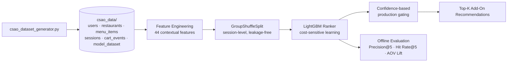

<div align="center">


</div>

## 📌 Overview

Customers ordering food often miss relevant add-on items that would round out their cart, which leaves money on the table for the platform and a less complete order for the customer. This project was built for **Zomathon**, Zomato's hackathon, and tackles that gap with **CSAO — Cart Super Add-On** — a real-time, context-aware recommendation system that suggests the right add-ons for a cart. It ranks every menu item from the restaurant as a candidate, scores them with a LightGBM ranker trained on 40+ engineered features, and serves suggestions under a strict ≤300ms latency budget, aiming to lift Average Order Value while keeping acceptance rates high.

## ✨ Features

- 🛒 Full-menu candidate pool — every item from the restaurant is considered, not just a shortlist
- 🧮 44 engineered contextual features spanning cart complementarity, user affinity, price sensitivity and context
- 🚦 `GroupShuffleSplit` session-level train/test split to prevent session leakage
- 🌳 LightGBM ranker with cost-sensitive learning (`scale_pos_weight`)
- 🎯 Confidence-based production gating strategy before a recommendation is shown
- ❄️ Cold-start fallbacks — segment-based priors for new users, cuisine-similarity inheritance for new restaurants, Bayesian-smoothed category priors for new menu items
- 📈 Simulated business-impact evaluation (AOV lift, Precision@5, Hit Rate@5)
- 🧪 Synthetic but realistic dataset generator mimicking real food-delivery dynamics across 6 Indian cities

## 🛠️ Tech Stack

| Layer | Technology |
|---|---|
| Language |  |
| Modeling |   |
| Data |   |
| Experimentation |  |

## 🏗️ Architecture



## 📂 Project Structure

```
zomathon-csao/
├── csao_data/
│   ├── users.csv
│   ├── restaurants.csv
│   ├── menu_items.csv
│   ├── sessions.csv
│   ├── cart_events.csv
│   └── model_dataset.csv
├── csao_dataset_generator.py   # synthetic dataset generator
├── csao_model_baseline.ipynb   # feature engineering, training, evaluation
└── README.md
```

## ⚙️ Installation

```bash
git clone https://github.com/Fayaz-2007/zomathon-csao.git
cd zomathon-csao

pip install pandas numpy scikit-learn lightgbm jupyter
```

No `.env` file or external services are used — the project runs entirely on the synthetic dataset generated locally.

## 🚀 Usage

**1. Generate the dataset**

```bash
python csao_dataset_generator.py
```

This creates `users_df`, `restaurants_df`, `menu_items_df`, `sessions_df`, `cart_events_df` and the final engineered `model_dataset_df`, saving all six as CSVs inside `csao_data/`.

**2. Train and evaluate the model**

Open `csao_model_baseline.ipynb` and run all cells to:
- Build the full-menu candidate set and engineer the 44 contextual features
- Split sessions with `GroupShuffleSplit` to avoid leakage
- Train the baseline and the final LightGBM ranker
- Compute ranking metrics (Precision@5, Hit Rate@5) and simulate AOV impact

`[Screenshot: Precision@5 / Hit Rate@5 evaluation output]`

`[Screenshot: simulated AOV lift chart]`

## 🔮 Future Improvements

- Wrap the trained model behind a real-time inference API instead of notebook-only evaluation
- Replace the synthetic dataset with real transaction logs once available
- Add an online A/B testing harness to validate the simulated AOV lift in production
- Expand cold-start handling with embedding-based similarity instead of static priors

## 👨‍💻 Author

**Fayaz Ahmed**
GitHub: [@Fayaz-2007](https://github.com/Fayaz-2007)
LinkedIn: [fayaz-ahmed-59287631a](https://linkedin.com/in/fayaz-ahmed-59287631a)

<div align="center">


</div>
